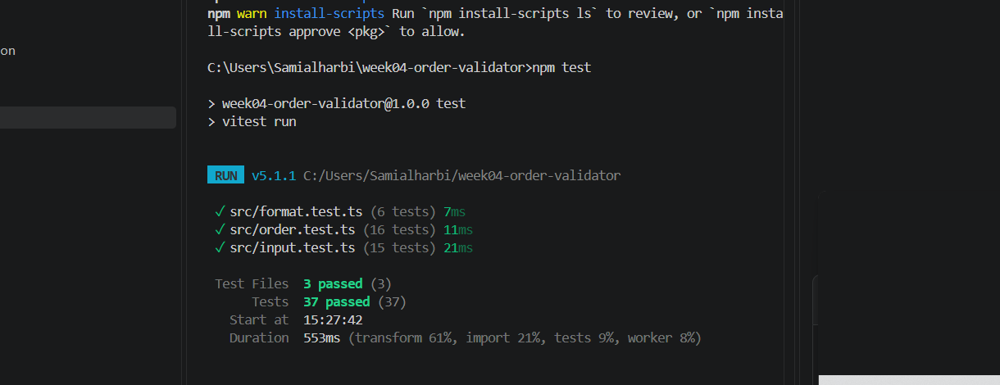
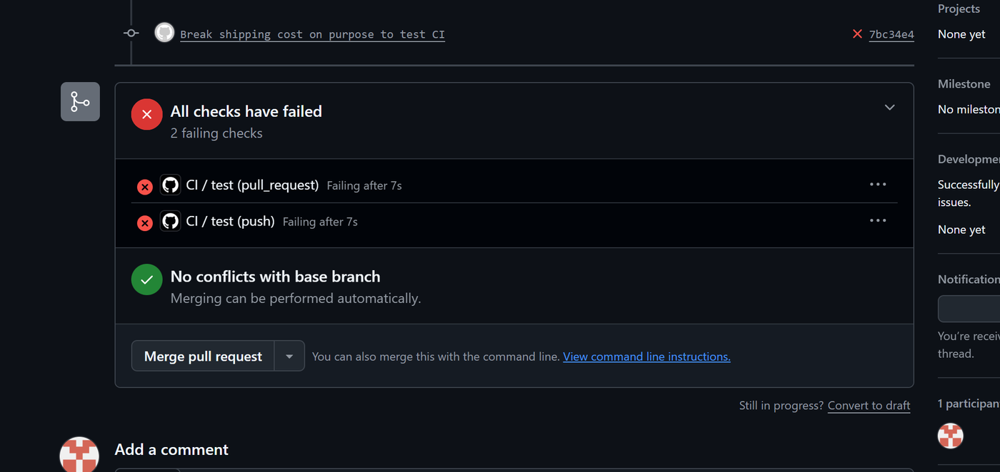
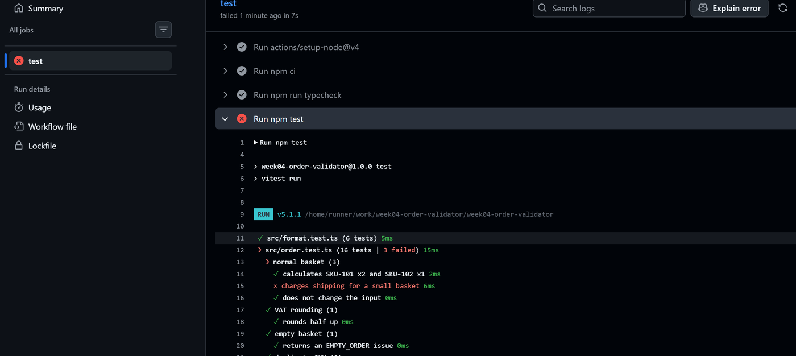
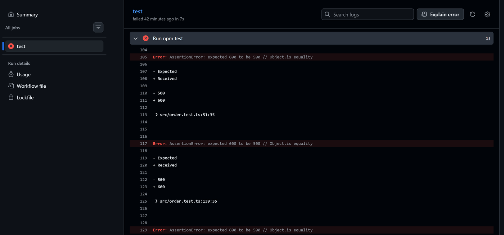
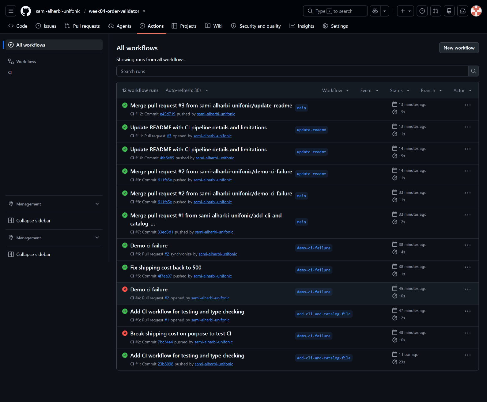
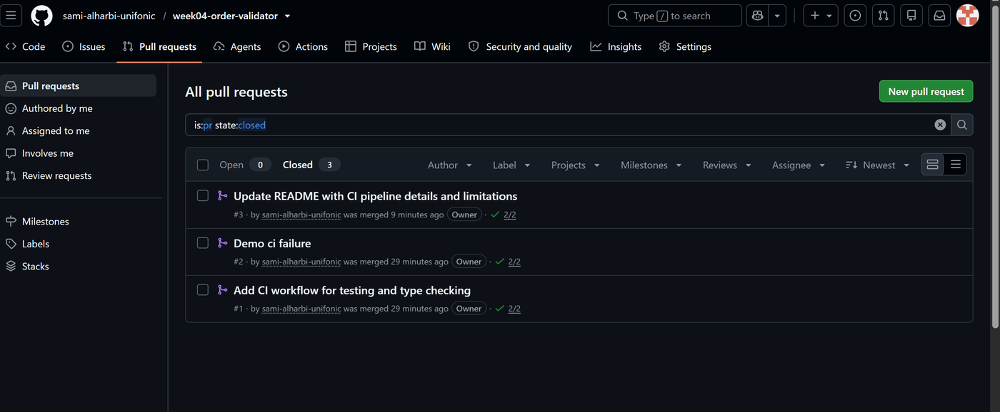

# Week 04 Order Validator

A small TypeScript library that checks a checkout order and calculates its total. It uses fictional data only.

## How to run

You need Node.js 22.12 or newer.

```bash
npm install
npm test
npm run typecheck
```

`npm test` runs the tests. `npm run typecheck` checks the types, and no errors means it passed.

## Command line demo

```bash
npm run demo -- samples/good-order.json
npm run demo -- samples/bad-order.json
```

The `samples` folder has example orders and their saved outputs. The products are read from `data/catalog.json`.

## Rules

- Prices are whole numbers in cents. Currency is RSD.
- Shipping is 500 cents, free when the subtotal is over 10000.
- VAT is 20 percent and already included in the prices and in shipping. It is rounded half up.
- The same SKU on two lines is merged into one.
- Every bad line (unknown SKU, out of stock, too many, quantity 0) returns an issue.

## Test result

37 tests passed. The type check finished with no errors. No blockers.



## Extra: automatic checks on GitHub

The assignment did not ask for a CI pipeline or any automation. I added one myself as an experiment, because running the tests automatically is the natural next step.

The workflow is in `.github/workflows/ci.yml`. On every push and pull request, GitHub runs the type check and the tests.

To test it, pull request #2 changed the shipping cost from 500 to 600 on purpose. The check failed with 3 failed tests. After changing it back to 500, the check passed.

**The failed check on the pull request**



**The failed test log: the type check passed, but the tests failed**



**The error: the code gave 600, the test expected 500**



**All the runs: red for the deliberate break, then green after the fix**



**All three pull requests merged with their checks passed**



## Known limitations

- Only one currency (RSD).
- Messages are in English only.
